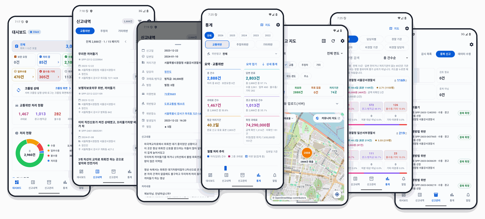
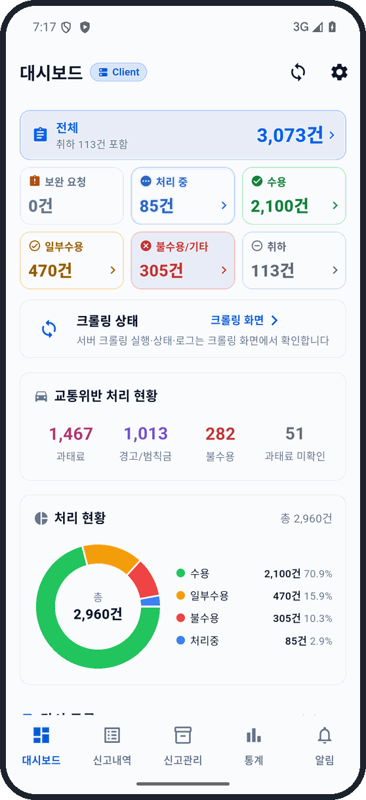
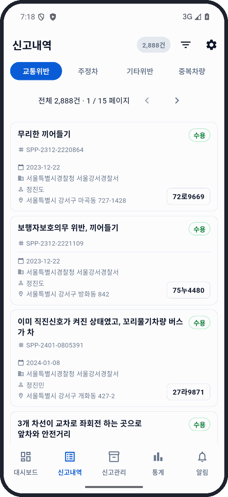
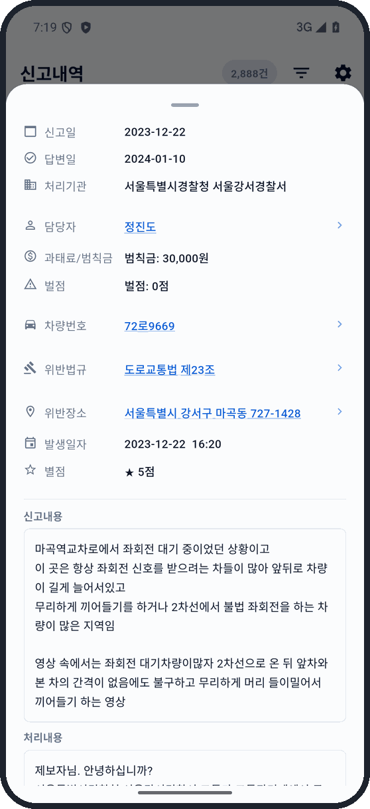
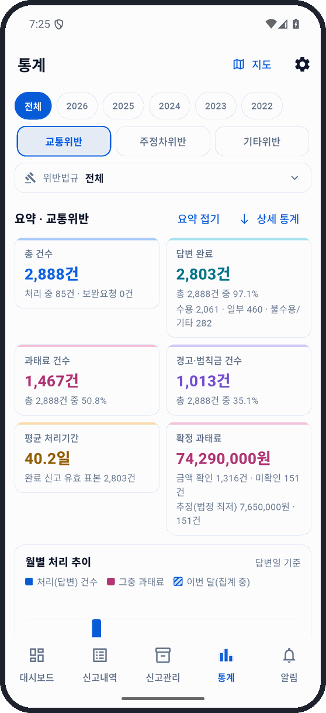
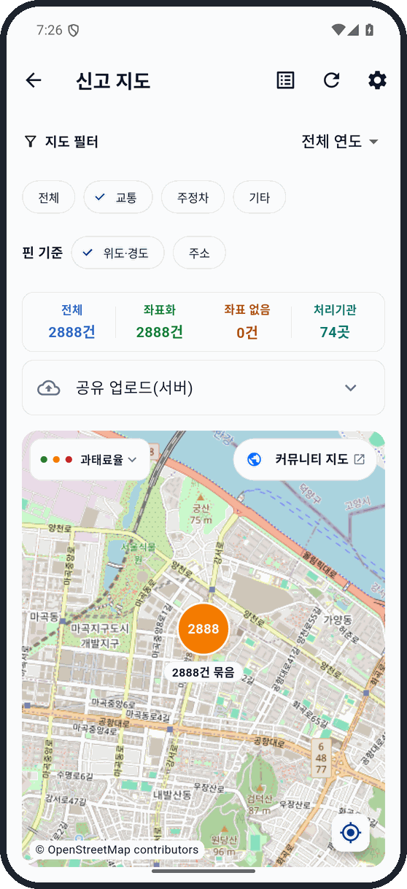
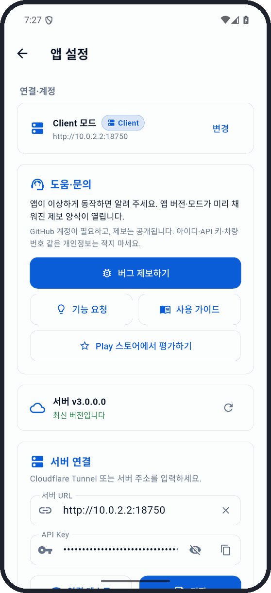

# 나만의 안전신문고 — Android 앱

  

> 안전신문고에 신고한 내역을 한곳에 모아 보여 주고, 처리 결과가 나오면 알려 주는 Android 앱입니다. 
> 신고할 때마다 안전신문고 앱을 열어 하나하나 확인할 필요 없이, 과태료가 나왔는지·불수용됐는지·어느 기관이 빨리 처리하는지를 한눈에 볼 수 있습니다.

  <picture>
    <source media="(prefers-color-scheme: dark)" srcset="example-dark.png" />
    
  </picture>

> ⚠️ 이 앱은 안전신문고의 **공식 앱이 아닙니다.** 행정안전부나 정부기관과 관계없는 개인 개발 앱이며,
> 내 신고 내역을 보기 좋게 정리해 주는 도구입니다. 신고 접수와 민원 처리는 안전신문고 공식 앱·웹에서 해 주세요.

📖 **화면별 자세한 사용법**: [나만의 안전신문고 사용 안내](https://hb.worklazy.net/mysafetyreport-pc-android-guide/)

---

## 이런 게 됩니다

- **처리 결과 알림** — 신고 처리 상태가 바뀌면(답변 완료, 수용, 과태료 부과 등) 알림으로 알려 줍니다.
- **내 신고 한눈에 보기** — 교통위반·주정차·안전신고·생활불편·기타 신고를 한 화면에서. 과태료·경고·불수용 같은 처분 결과가 색으로 구분돼 보입니다.
- **통계** — 총 신고, 답변 완료, 처리 중, 평균 처리 기간을 카드로 보여 주고, 월별 신고·답변 추이를 그래프로 그려 줍니다.
  기관별·담당자별로 과태료가 얼마나 나왔는지, 처리가 얼마나 걸렸는지도 비교할 수 있습니다.
- **같은 차량 모아 보기** — 같은 차를 여러 번 신고했다면 차량번호별로 묶어서 보여 줍니다.
- **중복 신고 정리** — 같은 내용으로 두 번 접수된 신고를 찾아 대표 1건으로 묶을 수 있습니다.
- **감시 목록** — 꼭 챙겨 볼 신고를 따로 모아 둡니다.
- **별점(만족도 조사) 한꺼번에** — 여러 신고를 골라 한 번에 별점을 줄 수 있습니다. 이미 참여했거나 아직 답변이 없는 신고는 알아서 건너뜁니다.
- **신고 지도** — 안전신문고 답변에 들어 있는 공식 좌표로 신고 위치를 지도에 모아 보여 줍니다. 핀 기준을 `위도·경도` / `주소`로 바꿀 수 있고, 오른쪽 위 **커뮤니티 지도** 버튼은 휴대폰의 기본 브라우저로 [safemap.worklazy.net](https://safemap.worklazy.net/)을 엽니다.
- **엑셀 내보내기** — 신고 내역을 엑셀 파일로 저장합니다.
- **다크 모드** — 밝은 화면/어두운 화면/기기 설정 따라가기 중에서 고를 수 있습니다.
- **원문 바로가기** — 신고 상세에서 안전신문고 앱이나 공식 사이트로 바로 이동할 수 있습니다.

별도 PC나 서버 없이 **앱 하나로** 씁니다. 앱이 내 안전신문고 계정으로 직접 로그인해서 신고 내역을 가져옵니다.

---

## 다운로드

- [Google Play 스토어](https://play.google.com/store/apps/details?id=com.fentanest.mysafetyreport)

배포는 Google Play 를 통해서만 합니다. **Android 7.0 이상**에서 쓸 수 있습니다.

---

## 처음 시작하기

1. 앱을 열면 안전신문고 로그인 화면이 나옵니다. 안전신문고 **아이디·비밀번호**와 **휴대폰번호**를 입력합니다.
   (휴대폰번호는 별점을 주거나 내가 준 별점·사유를 확인할 때만 씁니다.)
   로그인 화면 아래 **Demo 보기**를 누르면 로그인 없이 가상 신고 100건으로 주요 화면을 둘러볼 수 있습니다.
2. 카카오 로그인과 신고 내용 공유 동의를 마칩니다. 동의 전에는 내 신고 내역을 볼 수 없습니다.
3. 필요한 권한을 설정합니다(나중에 설정에서 바꿀 수 있습니다).
4. 대시보드의 **동기화**로 첫 수집을 합니다. 지금까지의 신고 내역을 모두 가져오므로 신고가 많으면 시간이 걸립니다(대략 신고 1건에 1초).
   앱을 쓰는 동안 뒤에서 진행되고, 중간에 멈춰도 다음 동기화에서 이어서 받습니다.
5. 이후 새 답변은 **동기화**를 누르거나, 알림 자동 감지(아래)로 확인합니다. 정해진 시각에 저절로 도는 자동 동기화는 없습니다.

### 알림으로 자동 확인하기 (선택)

설정에서 **알림 접근 권한**을 허용하면, 카카오톡이나 안전신문고 앱에 신고 관련 알림이 올 때
앱이 그 신고만 골라서 바로 확인하고, 처리 상태가 바뀌었으면 알려 줍니다.

### 로그인은 이렇게 지켜집니다

- 비밀번호는 휴대폰의 보안 저장소에 암호화해서 저장하고, 안전신문고 외에는 어디에도 보내지 않습니다.
- 안전신문고 로그인이 풀려도 앱이 저장된 정보로 **알아서 다시 로그인**합니다.
- 안전신문고에서 비밀번호를 바꾸는 등 다시 로그인해야 할 때는, 대시보드 맨 위에 **"재로그인이 필요합니다"** 안내가 뜨고
  하루에 한 번 확인해서 **알림**으로도 알려 줍니다. 안내의 **재로그인** 버튼을 누르면 바로 로그인 창이 열립니다.
- 인터넷이 잠깐 끊겼거나 안전신문고가 점검 중일 때는 재로그인을 요구하지 않고 "잠시 후 다시 시도"라고 알려 줍니다.

---

## PC 버전(Client 방식)을 쓰던 분께

PC 버전(집에 켜 둔 PC·라즈베리파이 수집 서버와 연결하는 Client 방식)은 서비스를 종료했습니다. 이제 앱 하나로 씁니다.

업데이트 후 처음 실행하면 **Standalone 모드로 전환** 안내가 나옵니다.

- **확인** — PC 버전에 접속해 신고 DB를 받아 앱 형식으로 바꾼 뒤, 안전신문고 로그인 화면으로 넘어갑니다. 로그인하면 받은 DB가 들어갑니다.
  PC 버전이 켜져 있고 PC 버전의 카카오 로그인·공유 동의가 살아 있어야 합니다.
  PC 버전에서 이미 최신 기준으로 모아 둔 자료라면 전체를 다시 받지 않고 바로 씁니다.
- **나중에 하기** — PC 버전에서 DB를 백업한 뒤, 앱의 **설정 › 데이터 관리 › DB 복원**으로 옮기세요. 동기화하기 전에 복원하는 것이 좋습니다.

같은 카카오 계정으로 만든 DB만 옮길 수 있습니다. 감시 목록, 직접 수정한 값, 중복 신고 정리도 함께 옮겨집니다.

---

## 화면 둘러보기

<table>
  <tr>
    <td align="center" width="33%"> <b>대시보드</b> 처리 결과를 색깔 카드로 한눈에</td>
    <td align="center" width="33%"> <b>신고내역</b> 분류별 목록, 차량번호와 처리상태까지</td>
    <td align="center" width="33%"> <b>신고 상세</b> 처리 결과·과태료·담당 기관과 답변 내용까지</td>
  </tr>
  <tr>
    <td align="center"> <b>통계</b> 총 신고·답변 완료·평균 처리기간, 월별 추이</td>
    <td align="center"> <b>신고 지도</b> 신고한 곳을 지도에서</td>
    <td align="center"> <b>설정</b> 버그 제보·가이드·테마를 맨 위에서</td>
  </tr>
</table>

아래쪽 탭 5개로 움직입니다.

| 탭 | 무엇을 보나요 |
|----|------|
| **대시보드** | 전체·수용·불수용·처리 중 건수, 교통위반 처리 현황, 감시 목록, 최근 3일 사이 답변 온 신고. 동기화 상태 카드와 오른쪽 위 버튼에서 동기화 화면으로 갑니다. |
| **신고내역** | 교통위반 / 주정차 / 안전신고 / 생활불편 / 기타 / 같은 차량 묶음. 검색과 상세 필터(처리상태, 별점, 위반법규, 기관 등)로 원하는 신고만 골라 봅니다. |
| **신고관리** | 별점 주기 / 감시 목록 / 중복 신고 / 데이터 수정 |
| **통계** | 요약 카드와 월별 추이 그래프, 기관별·담당자별 처리 결과(항목을 누르면 해당 신고 목록), 맨 아래 전국 안전신고 현황(안전신문고 공개 통계 — 내 신고 통계와 다른 자료). 앱바의 **지도**로 신고 지도를 엽니다. |
| **알림** | 지금까지 받은 알림 기록(동기화 현황 / 신고 결과 / 별점 주기) |

오른쪽 위 **톱니바퀴**를 누르면 설정이 열립니다. 테마 선택, 권한, 백업·복원과 **파일 관리**(설정 › 데이터 관리), 도움·문의가 모여 있습니다.

**알아 두면 편한 것**

- 신고 카드를 **길게 누르면** 여러 개를 고를 수 있습니다. 고른 신고를 복사하거나, 감시 목록에 넣거나, 한 번에 별점을 줄 수 있습니다. **뒤로 가기**를 누르면 선택이 풀립니다.
- 신고 상세의 **첨부 동영상은 화면에 보이면 알아서 불러옵니다.** 스크롤하는 동안에는 기다렸다가 한 개씩 불러와서 화면이 버벅이지 않습니다.
- 처리상태는 색으로 구분됩니다: 보완 요청(주황), 처리 중(파랑), 답변 완료(청록), 수용(초록), 일부수용(노랑), 불수용·기타(빨강), 취하(회색), 과태료(분홍), 경고·범칙금(보라).
- 안전신문고가 보완을 요청한 신고는 **누가 언제 요청했는지, 몇 번째 보완인지**까지 상세에서 볼 수 있습니다.

---

## 자주 묻는 질문

**Q. 앱을 업데이트했는데 카카오 로그인·동의 화면이 나와요.**
A. 카카오 로그인과 현재 동의 내용 확인이 필요합니다. 한 번 연결하고 동의하면 앱을 다시 열 때 반복하지 않습니다. 로그인이 만료되거나 동의 내용이 바뀌면 다시 확인합니다.

**Q. 업데이트 후 "신고 내역 다시 불러오기" 안내가 나와요.**
A. 신고 분류 기준이 안전신문고 공식 분류(교통위반·주정차·안전신고·생활불편·기타)로 바뀌어, 저장된 신고를 한 번 다시 불러옵니다.
앱을 쓰는 동안 뒤에서 진행되고, 앱을 닫았다가 다시 열면 이어서 합니다.

**Q. 비밀번호가 안전한가요?**
A. 휴대폰의 보안 저장소(Android Keystore)에 암호화해 저장하고, 안전신문고 로그인에만 씁니다.

**Q. "재로그인이 필요합니다"라는 안내가 떠요.**
A. 안전신문고가 저장된 비밀번호를 받아 주지 않는 경우입니다(비밀번호를 바꿨거나 계정이 잠긴 경우 등). 안내의 **재로그인** 버튼을 눌러 다시 로그인해 주세요.

**Q. "안전신문고에 연결하지 못했습니다"라고 떠요.**
A. 인터넷이 끊겼거나 안전신문고가 점검 중일 때 나옵니다. 다시 로그인할 필요는 없고, 잠시 후 다시 시도하면 됩니다.

**Q. "다른 동기화가 진행 중입니다" / "약 N분 뒤 다시 눌러 주세요"라고 떠요.**
A. 이미 동기화가 돌고 있거나, 앱이 동기화 도중 강제로 꺼져 정리 중일 때 나옵니다. 안내된 시간(최대 5분)이 지난 뒤 다시 눌러 주세요.

**Q. 동기화하다가 앱을 닫아도 되나요?**
A. 동기화 중에는 뒤로 가기로 앱을 닫지 못하게 막고 "동기화 중에는 앱을 종료할 수 없습니다" 안내가 나옵니다. 진행 상황은 동기화 화면과 알림 표시줄에서 볼 수 있습니다.

**Q. 카카오 로그아웃을 하면 어떻게 되나요?**
A. 이 휴대폰에 저장된 신고 내역이 지워집니다(감시 목록은 남음). 같은 카카오 계정으로 다시 연결한 뒤 동기화하거나 백업해 둔 DB를 복원하세요. 다른 카카오 계정의 DB는 복원할 수 없습니다.

**Q. 이 앱에서 신고를 할 수 있나요?**
A. 아니요. 이미 접수한 신고를 모아 보고 관리하는 앱입니다. 신고 접수는 안전신문고 공식 앱·웹에서 해 주세요.

**Q. 엑셀 파일을 눌렀는데 "열 수 있는 앱이 없습니다"라고 떠요.**
A. 휴대폰에 엑셀이나 구글 스프레드시트 같은 앱이 없으면 공유 화면이 대신 열립니다. 드라이브·메일 등으로 보내서 열어 보세요.

---

## 문제가 생기면 알려 주세요

앱의 **설정 맨 위 "도움·문의"** 카드에서 **버그 제보하기**를 누르면, 앱 버전이 미리 적힌 제보 양식(GitHub)이 열립니다.

- GitHub 계정이 필요하고, 제보 내용은 누구나 볼 수 있게 공개됩니다.
- **아이디·비밀번호·차량번호 같은 개인정보는 적지 마세요.**
- 같은 카드에서 기능 요청, 사용 가이드, Play 스토어 평가하기도 할 수 있습니다.

직접 가기: <https://github.com/Fentanest/safetyreport-mobile/issues>

---

## 라이선스

[LICENSE](LICENSE) 참조.
